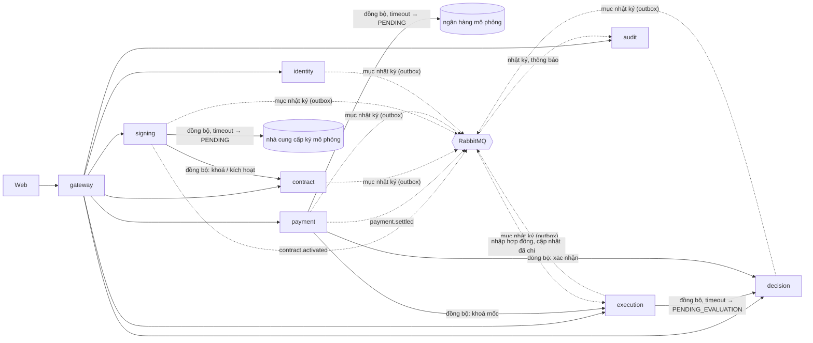
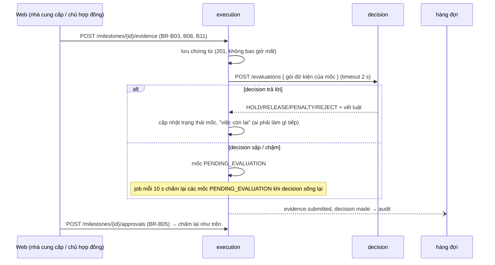

# Luận cứ kiến trúc: vì sao làm thế này, không làm thì sao

Mỗi thành phần ở đây phải trả lời ba câu: **giải quyết vấn đề gì cụ thể**, **không có nó thì hỏng ở
đâu**, **vì sao chọn cái này mà không chọn cái khác**. Cái gì không trả lời được thì không làm. Dùng
tệp này cho chương kiến trúc của báo cáo và để trả lời vấn đáp. Thiết kế chi tiết:
`docs/PHAN_TICH_THIET_KE.md`; toàn cảnh kỹ thuật: `docs/HE_THONG.md`.

**Luật cập nhật**: thêm hay bỏ một công nghệ, một hàng đợi, một service → thêm hay sửa một dòng ở
§3 hoặc §4 kèm lý do, trong cùng PR.

## 1. Bài toán thật và tải thật

Hợp đồng dịch vụ, phần mềm, thi công trả tiền theo **mốc**. Mỗi lần chi một mốc, ngày nay kế toán và
chủ hợp đồng phải đối chiếu bằng tay: đủ biên bản và hoá đơn chưa, đúng người có thẩm quyền ký chưa,
đủ người duyệt chưa, có đang tranh chấp không, trễ bao nhiêu ngày sau ân hạn và phạt bao nhiêu, đã chi
chưa (tránh chi hai lần). Sai ở đâu cũng là **mất tiền hoặc kiện tụng**, và khi kiểm toán hỏi "vì sao
chi" thì không ai tái dựng được.

Hệ thống giải quyết bằng: điều kiện chi viết thành **luật có phiên bản**; mọi chứng từ, phê duyệt,
tranh chấp đi qua hệ thống; engine chấm lại mốc sau mỗi thao tác, ra quyết định **kèm vết luật**; lệnh
chi chỉ tạo được từ một quyết định trả tiền, và **không thể chi hai lần**; mọi thao tác vào nhật ký
**không sửa được** (chuỗi băm).

Tải: Data Pack của ban tổ chức có 100 hợp đồng, 405 mốc, 1.134 sự kiện, 65 bên. Một doanh nghiệp vừa
cỡ vài nghìn hợp đồng mỗi năm, vài chục thao tác ghi mỗi phút lúc cao điểm. **Đây không phải bài toán
tải lớn.** Một ứng dụng nguyên khối (monolith) chia mô-đun chạy thừa sức, và CodeCash đã chạy đúng
như vậy.

Vì vậy, ta **không** biện minh microservices bằng hiệu năng. Lý do thật là:

1. **Ranh giới rủi ro khác nhau.** Chữ ký có giá trị pháp lý; dòng tiền cần chống chi trùng; engine
   phải tái lập được kết quả; nhật ký phải độc lập với người bị kiểm toán. Tách ra thì lỗi hoặc thay đổi
   ở phần soạn thảo không chạm tới phần chi tiền, và mỗi phần có quyền truy cập dữ liệu riêng.
2. **Phụ thuộc ngoài không đáng tin**: nhà cung cấp ký số, ngân hàng. Cần cô lập để khi chúng chậm
   hoặc sập thì phần còn lại vẫn chạy (§5, §6).
3. **Ngôn ngữ khác nhau**: engine Python đã kiểm chứng 405/405 quyết định. Viết lại sang TypeScript là
   rủi ro lớn nhất có thể tránh.
4. **Sáu người làm song song** trong ba tuần: mỗi người một repo, không giẫm chân (`KIEN_TRUC_REPO.md`).
5. Môn Kiến trúc Microservices yêu cầu.

Câu nên nói khi vấn đáp: *"Với tải này, monolith là đủ; nhóm chọn microservices vì ranh giới rủi ro và
phụ thuộc ngoài, và đã trả giá bằng saga, outbox, idempotency; đây là các chi phí đó."*

## 2. Tách service: đủ chưa, đúng chưa

| Service | Vì sao là một service riêng | Nếu gộp vào cái khác thì sao |
| --- | --- | --- |
| identity | Mọi service cần xác thực; chỉ một nơi giữ mật khẩu và khoá ký token | Lộ mật khẩu ở nhiều database; service nào cũng ký được token |
| contract | Vòng đời soạn thảo: nhiều phiên bản, rà soát qua lại, khoá khi đồng ý. Đổi nhiều nhất | Bản nháp đổi liên tục lẫn với dữ liệu đang thực hiện; khoá điều khoản khó làm |
| signing (gồm tài liệu) | Giá trị pháp lý: văn bản đóng băng, mã băm, thứ tự ký; gọi nhà cung cấp ký ngoài | Tách tài liệu khỏi ký thì mỗi lượt ký gọi chéo để kiểm mã băm mà không bớt rủi ro → **gộp là đúng** |
| execution | Hợp đồng đang chạy: mốc, chứng từ, phê duyệt, tranh chấp. Nhận **ảnh chụp bất biến** của hợp đồng đã ký | Gộp với contract thì sửa bản nháp có thể đụng hợp đồng đang thực hiện; tách phê duyệt khỏi chứng từ thì mỗi lần chấm phải gọi chéo |
| decision (Python) | Hàm thuần, có phiên bản luật, khác ngôn ngữ; phải tái lập được kết quả | Viết lại engine sang TS: mất bằng chứng 405/405 |
| payment | Dòng tiền: lệnh chi, ngân hàng, idempotency, đối soát | Lỗi ngân hàng kéo sập phần thực hiện; quyền chi lẫn với quyền nộp chứng từ |
| audit (gồm thông báo) | Kiểm toán phải độc lập với bên bị kiểm toán; nhận sự kiện của mọi service | Mỗi service tự giữ nhật ký thì không có một nơi kiểm toàn bộ |
| gateway | Không phải nghiệp vụ: một cửa vào, kiểm token, giới hạn | §4 |

Đủ: 6 service nghiệp vụ (đề cần ≥ 5). **Không tách thêm**: thông báo nằm trong audit vì cùng là
"người nghe mọi sự kiện", tách ra chỉ thêm một repo, một database. Tài liệu nằm trong signing vì lý do
ở bảng trên.

Ba chỗ dễ làm sai khi tách, đã chốt:

1. **Ai sở hữu tổ chức.** identity sở hữu `organizations` (công ty, mã số thuế). execution có `parties`
   của Data Pack: đây là **bản sao chỉ đọc** theo mã của identity, đến qua gói hợp đồng (S2) hoặc lúc
   nạp Data Pack, không bao giờ sửa ở execution.
2. **Hợp đồng nằm ở hai nơi** là cố ý, giống "đơn hàng" và "giao hàng" trong thương mại điện tử.
   contract giữ bản đang soạn; execution giữ ảnh chụp đã ký (gói v1, kèm mã băm văn bản). Ký xong, sửa
   chỉ bằng phụ lục ở execution, không sửa bản nháp.
3. **decision không gọi ngược execution.** execution gửi trọn **gói dữ kiện của một mốc** (mốc, hợp
   đồng, các bên, sự kiện, luật) trong request; decision tính rồi lưu kết quả và vết. Như vậy đồ thị gọi
   đồng bộ không có vòng (§5), và decision chạy được độc lập, dễ test và đo.

## 3. Đồng bộ hay bất đồng bộ, vì sao

Nguyên tắc: **gọi đồng bộ khi người dùng cần kết quả ngay và bên gọi không làm được gì nếu không có nó.
Bất đồng bộ khi bên phát không được phép phụ thuộc vào việc bên nhận đang sống, và kết quả đến chậm vài
giây vẫn đúng.**

| Tương tác | Kiểu | Vì sao |
| --- | --- | --- |
| Web → gateway → một service (mọi lần đọc, mọi thao tác) | đồng bộ HTTP | người dùng chờ kết quả |
| signing → contract: `AGREED → SIGNING`, `SIGNING → ACTIVE` | đồng bộ | phải biết chắc hợp đồng đã khoá trước khi cho ký |
| signing → nhà cung cấp ký | đồng bộ, timeout 3 s → PENDING | người ký chờ; hết giờ thì "đã nhận, chưa biết", đối soát sau |
| execution → decision: chấm mốc sau chứng từ, phê duyệt | đồng bộ, timeout 2 s → PENDING_EVALUATION | người duyệt muốn thấy ngay "đủ điều kiện chưa"; decision sập thì không mất chứng từ |
| payment → execution (khoá mốc), payment → decision (xác nhận) | đồng bộ | là các bước của saga S4, phải biết kết quả từng bước |
| payment → ngân hàng | đồng bộ, timeout 3 s → PENDING | như nhà cung cấp ký |
| signing → execution: hợp đồng đã ký (`contract.activated`) | **bất đồng bộ** | chữ ký đã có giá trị; execution sập lúc đó không được làm hỏng lượt ký, và không được mất hợp đồng |
| Mọi service → audit: mục nhật ký | **bất đồng bộ** | nhật ký trung tâm không được làm chậm hay chặn thao tác của người dùng |
| Mọi service → thông báo, email | **bất đồng bộ** | gửi mail chậm, hay lỗi; người dùng không chờ mail |
| payment → execution: đã chi (`payment.settled`) | **bất đồng bộ** | ngân hàng có thể báo về muộn (đối soát); mốc đổi sang đã chi khi có kết quả |

**Đường đọc không có lời gọi chéo.** Màn danh sách, việc cần làm, chi tiết mốc (các thao tác nhiều
nhất) chỉ đi web → gateway → **một** service, vì mỗi service có đủ dữ liệu của mình (nhờ ảnh chụp ở
§2). Lời gọi chéo chỉ xảy ra ở vài bước chuyển trạng thái. Đây là lý do 7 service vẫn nhanh như một.

## 4. Từng công nghệ: giải quyết gì, không có thì sao

| Thành phần | Giải quyết gì | Không có thì sao | Vì sao chọn cái này |
| --- | --- | --- | --- |
| **API gateway** (tự viết, `gateway/`) | Một địa chỉ cho web và Postman; kiểm token lớp 1; giới hạn số request; CORS; request id; 503/504 thống nhất | Web phải biết 7 cổng, CORS cấu hình 7 nơi, service lộ ra ngoài, không chặn được dò mật khẩu ở một chỗ | Tự viết ~250 dòng: giải thích được từng chính sách khi vấn đáp, không có luật nghiệp vụ. Kong/Traefik mạnh hơn nhưng là cấu hình, không chấm được kiến thức, và thêm một hệ phải học |
| **JWT RS256 + JWKS** | Service kiểm token không cần gọi identity; chỉ identity ký được | Mỗi request gọi identity (identity thành điểm nghẽn, sập là cả hệ sập); hoặc dùng chung một bí mật (lộ một service là giả được token của mọi người) | Chuẩn OAuth/OIDC; HS256 với bí mật chung đã bỏ vì lý do trên |
| **Access 15 phút + refresh xoay vòng** | Service khác không kiểm thu hồi, nên token bị lộ chỉ dùng được tối đa 15 phút; refresh token bị chép thì phát hiện khi dùng lại | Token 8 giờ: khoá tài khoản xong người đó vẫn thao tác cả ngày ở service khác | OAuth 2.0 Security BCP; cookie HttpOnly để script trên trang không đọc được |
| **Database riêng mỗi service** (cùng một máy Postgres) | Không service nào đọc trộm bảng của service khác; đổi schema không làm vỡ ai | Ai cũng join bảng của nhau → thực chất là monolith phân tán, sửa một bảng vỡ ba service | Một máy Postgres nhiều database: đúng ranh giới mà không tốn 7 máy chủ; ở thật thì tách máy khi cần |
| **Saga điều phối + bù trừ** (S1, S4) | Thay giao dịch xuyên database (không có) | Lỗi giữa chừng để lại hợp đồng kẹt ở `SIGNING`, hay mốc kẹt `PAYMENT_REQUESTED` mãi | Điều phối tập trung dễ log, dễ giải thích hơn "choreography" (mỗi service tự phản ứng sự kiện). 2PC không dùng được qua HTTP và khoá dữ liệu lâu |
| **Idempotency-Key** khi chi tiền và khi ký | Gửi lại sau timeout không tạo lệnh thứ hai | Timeout lúc ngân hàng đã chi → bấm lại → **chi hai lần**. Đây là lỗi đắt nhất của hệ | Cách các API thanh toán làm: Stripe dùng đúng header này; cổng thanh toán trong nước dùng mã giao dịch duy nhất cho cùng mục đích |
| **Trạng thái PENDING + job đối soát** | Thành thật với "đã gửi nhưng không biết kết quả" | Đoán thành công (có thể chưa chi) hoặc đoán thất bại (gửi lại → chi trùng) | Đây là cách ngân hàng thật vận hành; job hỏi lại theo khoá |
| **Outbox** (ghi sự kiện cùng giao dịch với dữ liệu) | Không mất sự kiện khi service chết giữa "ghi DB" và "gửi sự kiện" | Hợp đồng đã ký nhưng execution không bao giờ biết; chi xong nhưng mốc vẫn "chờ chi" | Chassis **đã** ghi mục nhật ký trong cùng giao dịch với dữ liệu (`Repository.mutate`): chính mục đó là hàng outbox, chỉ cần tiến trình đẩy đi |
| **Hàng đợi RabbitMQ** (§6) | Đệm và phát một sự kiện cho nhiều bên nhận; thử lại; DLQ giữ message hỏng | Xem §6: phần lớn làm được bằng outbox + HTTP; hàng đợi đáng dùng ở chỗ nhiều bên nhận | RabbitMQ: có sẵn dead-letter exchange, giao diện quản trị để demo, nhẹ. Kafka giữ log để phát lại ở quy mô lớn, cần cụm và vận hành nặng: thừa. Redis Streams nhẹ nhưng DLQ phải tự làm |
| **Consumer idempotent** (`processed-messages`) | Hàng đợi giao "ít nhất một lần"; message đến hai lần không được ghi hai lần | Nhập một hợp đồng hai lần, ghi một mục nhật ký hai lần | Bảng khoá duy nhất theo `messageId` là cách đơn giản và chắc nhất |
| **Circuit breaker + bulkhead** (chỉ quanh ngân hàng và nhà cung cấp ký) | Ngân hàng chậm thì ngừng gọi một lúc, trả lỗi nhanh, không dồn hàng trăm kết nối treo | Mỗi request chờ đủ timeout, kết nối dồn lên, gateway timeout lan sang cả những màn không liên quan | Chỉ đặt ở phụ thuộc **ngoài**, không đặt ở mọi lời gọi nội bộ (tải nội bộ thấp, thêm vào chỉ làm khó debug) |
| **Nhật ký chuỗi băm** | Kiểm toán biết có ai sửa hay xoá lịch sử không | Người có quyền DB sửa lại "ai duyệt, lúc nào" mà không ai biết | Mỗi mục chứa băm của mục trước; `GET /audit/verify` tính lại. Blockchain thật là thừa: không có nhiều bên không tin nhau cùng ghi |
| **Engine Python giữ nguyên** | Quyết định đã kiểm chứng 405/405 trên dữ liệu ban tổ chức | Viết lại: mất bằng chứng đúng, rủi ro sai số tiền | FastAPI bọc mỏng quanh `codecash_engine.evaluate` |
| **Docker + `docker compose`** | Máy chấm chạy cả hệ bằng một lệnh, đúng phiên bản (MS-R7) | "Máy em chạy được": thiếu Postgres, sai phiên bản Node, quên biến môi trường | Kubernetes giải quyết nhiều máy, tự co giãn: không có nhu cầu đó; compose là đủ và đề yêu cầu |
| **Request id xuyên service** | Lần một lỗi qua gateway → signing → contract bằng một mã | Ba service ba log, không biết dòng nào thuộc request nào | Header `x-request-id`, đã có sẵn. Grafana/Loki chỉ làm nếu dư thời gian |
| **k6** | Số liệu thí nghiệm lỗi trước và sau (MS-R8) | Không có số, chỉ có "em thấy nó chạy" | Viết kịch bản bằng JavaScript, chạy trong container |
| **ServiceClient** (timeout, thử lại có điều kiện) | Mọi lời gọi chéo cùng một quy tắc: không treo mãi, không thử lại 4xx, phân biệt lỗi nghiệp vụ và lỗi hạ tầng (MS-R5) | Mỗi người tự viết `fetch`, có chỗ không timeout, có chỗ thử lại cả POST chi tiền | Một thư viện trong chassis, có test |

## 5. Đồ thị phụ thuộc



Nét liền (đồng bộ) không có vòng: contract và decision không gọi ai; execution chỉ gọi decision;
payment gọi execution và decision. Nhờ vậy không có kiểu "A chờ B, B chờ A" khi một service chậm. Nét
đứt đi qua hàng đợi, nên bên phát không cần bên nhận đang sống.

## 6. Có cần hàng đợi không

Trả lời thẳng: **không cần cho luồng tiền và luồng quyết định**. Chúng đồng bộ, có PENDING và đối
soát; thêm hàng đợi chỉ làm khó theo dõi.

**Cần**, và chỉ ở ba chỗ, vì cùng một lý do (bên phát không được phụ thuộc bên nhận, và nhiều bên cùng
nhận):

1. **`contract.activated`** (S2): signing phát một lần, execution nhập hợp đồng, audit ghi, thông báo
   gửi cho hai bên. Không có hàng đợi thì signing phải gọi lần lượt ba nơi và tự thử lại từng nơi.
2. **Nhật ký về audit**: mọi service đều phát, mỗi thao tác một mục. Gọi HTTP đồng bộ thì audit chậm
   làm chậm mọi thao tác, audit sập thì không ai thao tác được.
3. **Thông báo**: email chậm và hay lỗi; người dùng không được chờ.

Nếu thiếu thời gian, phương án tối thiểu vẫn đúng: **outbox + tiến trình gửi HTTP có thử lại** (không
broker). Mất điểm cộng MS-B1 (+0,5) nhưng không mất tính đúng. Vì thế thứ tự làm là: outbox trước (bắt
buộc cho đúng), broker sau (điểm cộng và gọn hơn khi nhiều bên nhận).

## 7. Có cần CI không, vì sao GitHub Actions

CI trả lời câu "PR này có làm hỏng gì không" **trước khi** merge, cho cả sáu người, mỗi lần push. Không
có CI thì lỗi chỉ lộ ra ở ngày tích hợp, khi đã chồng lên bốn PR khác và không biết PR nào gây ra.

Ở đây CI làm năm việc, việc nào cũng chặn một lỗi thật đã gặp hoặc sẽ gặp:

| Bước | Chặn lỗi gì |
| --- | --- |
| `check-base-untouched` | AI "sửa chassis cho chạy được" trong repo service, lần đồng bộ sau xung đột |
| `check-docs-updated` | mã đổi mà `SERVICE.md` không đổi, AI lần sau đọc tài liệu sai |
| typecheck, lint, format, test (có Postgres thật) | lỗi kiểu, quên `await`, sai luật nghiệp vụ |
| build image và chạy ở chế độ production | thiếu biến môi trường (production đòi khoá ký token), thiếu tệp trong image |
| job `stack`: `docker compose up` + Newman qua gateway | service chạy riêng thì được, ghép lại thì không (sai route, sai cổng, token không qua gateway) |

**Vì sao GitHub Actions mà không CircleCI, GitLab CI, Jenkins:**

- Repo nằm trên GitHub và để **public**: GitHub Actions miễn phí, không giới hạn phút với runner
  chuẩn cho repo public. CircleCI gói miễn phí tính theo credit mỗi tháng; sáu người push cả ngày, cộng
  job build image và compose, dễ hết vào tuần cuối, đúng lúc cần CI nhất. (Nếu chuyển repo sang
  private, Actions còn một hạn mức phút miễn phí mỗi tháng; khi đó cần theo dõi, nhưng vẫn không lợi gì
  khi chuyển sang CircleCI.)
- **Gắn thẳng với bảo vệ nhánh**: "PR phải qua `verify`" là một ô tích trong cài đặt nhánh, không cần
  cài app hay webhook.
- Runner Ubuntu có sẵn Docker và service container Postgres: job `stack` chạy được không cần cấu hình
  thêm.
- Jenkins cần một máy chủ để tự nuôi; GitLab CI cần chuyển repo sang GitLab. Không có lợi ích nào bù
  được chi phí đó.

**CD (triển khai tự động) chưa cần.** Đề yêu cầu demo trực tiếp trên máy nhóm, chạy bằng compose. Nếu
làm mục "Could" (đường link có HTTPS), bước rẻ nhất là thêm vào job hiện có: build image rồi đẩy lên
GitHub Container Registry khi merge vào `main`; máy chủ demo chỉ `docker compose pull && up`. Không
dựng Kubernetes, không ArgoCD.

## 8. Các luồng chính: đi qua đâu, đồng bộ ra sao

Ký hiệu: **→** gọi đồng bộ qua `ServiceClient`; **⇢** sự kiện qua outbox và hàng đợi. Web luôn vào qua
gateway (lớp 1 kiểm token), không ghi lại ở mỗi dòng.

### L1. Đăng ký, đăng nhập, mời thành viên (xong)

web → identity. Không lời gọi chéo. identity ⇢ audit (`REGISTER`, `LOGIN`, `INVITE`…). Token RS256
phát ra; mọi service sau đó kiểm bằng JWKS, không gọi lại identity.

### L2. Soạn và rà soát hợp đồng (bên mua soạn, nhà cung cấp rà soát)

1. web → contract: tạo từ mẫu, sửa điều khoản, `PUT /milestones` (BR-A03…A05), `PUT /members`
   (BR-A06, A07). Lưu nháp nhiều lần, chỉ contract.
2. `SUBMIT_REVIEW` → `IN_REVIEW`; contract ⇢ `contract.review_requested` → audit gửi thông báo cho bên
   kia.
3. Nhà cung cấp bình luận, `REQUEST_CHANGES` hoặc `CONFIRM`. Hai bên cùng `CONFIRM` → `AGREED`
   (BR-A08); contract ⇢ `contract.agreed`.

Toàn bộ trong một service; tần suất cao nhất của nửa đầu vòng đời, không gọi chéo.

### L3. Ký và kích hoạt (S1, S2)

```mermaid
sequenceDiagram
  participant W as Web
  participant SG as signing
  participant C as contract
  participant SP as nhà cung cấp ký
  participant Q as hàng đợi
  participant E as execution
  W->>SG: POST /signing-sessions
  SG->>C: AGREED → SIGNING (khoá điều khoản)
  SG->>SG: dựng văn bản, đóng băng, mã băm; tạo lượt ký
  Note over SG,C: lỗi ở bước tạo lượt: huỷ văn bản, C về AGREED (bù trừ S1)
  loop từng người ký, đúng thứ tự (BR-A09)
    W->>SG: POST /steps/{n}/sign + Idempotency-Key
    SG->>SP: ký (timeout 3 s)
    alt hết giờ
      SG-->>W: 202 PENDING_PROVIDER (job đối soát hỏi lại)
    else xong
      SG-->>W: 200 SIGNED, lượt sau sang CURRENT
    end
  end
  SG->>SG: lượt cuối: niêm phong văn bản
  SG->>C: SIGNING → ACTIVE
  SG--)Q: contract.activated + gói hợp đồng v1 (outbox, cùng giao dịch)
  Q--)E: nhập ảnh chụp hợp đồng (idempotent theo contract.id)
  Q--)E: (execution đang sập: message nằm chờ, nhập khi sống lại)
```

### L4. Nộp chứng từ, phê duyệt, engine chấm (S3)



Đây là luồng chạy nhiều nhất của nửa sau. Chấm đồng bộ vì người duyệt cần thấy ngay "đã đủ điều kiện
chi chưa"; PENDING_EVALUATION để không phụ thuộc vào việc decision đang sống.

### L5. Tranh chấp, ngoại lệ, phụ lục

- Tranh chấp: web → execution mở (BR-B09) → chấm lại → HOLD (BR-B01). Bên mua đóng → chấm lại.
- Ngoại lệ (bỏ một chứng từ sai): chủ hợp đồng đề xuất, kiểm soát viên duyệt (BR-B12, SoD-2) → chấm lại.
- Phụ lục dời hạn: execution tạo, nhà cung cấp chấp nhận → hạn mốc mới → chấm lại.

Đều trong execution, mỗi lần đổi đều đi qua cùng một hàm chấm như L4.

### L6. Lập và chi lệnh (S4)

Sơ đồ ở `PHAN_TICH_THIET_KE.md` §8. Tóm tắt: web → payment `POST /payment-orders` + `Idempotency-Key`
→ execution khoá mốc `PAYMENT_REQUESTED` → decision xác nhận quyết định hiện hành còn trả tiền (BR-B10)
→ lệnh `APPROVED` → phê duyệt tài chính duyệt → ngân hàng (timeout 3 s, circuit breaker): `SENT` |
`PENDING` (đối soát theo khoá) | `FAILED` (bù trừ: trả mốc về trạng thái trước). Khi có kết quả:
payment ⇢ `payment.settled` → execution đánh dấu đã chi, audit ghi.

Vì sao chi tiền không dùng hàng đợi: phê duyệt tài chính phải thấy ngay "đã gửi", "đang chờ ngân hàng"
hay "bị từ chối"; mọi trường hợp không chắc đã có PENDING và đối soát lo.

### L7. Kiểm toán và xác minh

- Kiểm toán viên: web → audit `GET /audit/verify` tính lại chuỗi băm. Mỗi service giữ chuỗi băm của
  mình (cùng giao dịch với dữ liệu); audit nhận bản sao qua hàng đợi và đối chiếu mã băm đầu chuỗi của
  từng service, nên sửa ở một nơi là lộ.
- Khách: web → signing `GET /public/verify?hash=` → văn bản có đúng là bản đã niêm phong không.

### L8. Thanh lý

Mọi mốc đã chi hoặc bị từ chối → execution lập biên bản thanh lý với số liệu chốt (đã chi + phạt + bị
từ chối = giá trị hợp đồng) → nhà cung cấp xác nhận → hợp đồng khoá hẳn; execution ⇢ audit.

## 9. Những gì cố ý không làm

| Không làm | Vì sao |
| --- | --- |
| Kubernetes, service mesh | Không có nhu cầu nhiều máy, tự co giãn; compose đủ và đề yêu cầu |
| Kafka | Không cần giữ log để phát lại ở quy mô lớn; RabbitMQ đủ và nhẹ |
| Blockchain thật | Không có nhiều tổ chức không tin nhau cùng ghi; chuỗi băm + neo Merkle đạt mục đích kiểm toán |
| Circuit breaker ở mọi lời gọi nội bộ | Tải nội bộ thấp; chỉ đặt ở ngân hàng và nhà cung cấp ký |
| Cache (Redis) | Đường đọc một service, dữ liệu nhỏ; chưa có số đo nào cho thấy chậm |
| GraphQL / BFF | Mỗi màn gọi một service; REST + OpenAPI là đề yêu cầu |
| Event sourcing | Trạng thái hiện tại + nhật ký chuỗi băm đủ để tái dựng "vì sao"; event sourcing tăng độ khó mà không thêm điều gì cần |

## 10. Rủi ro và cách giảm

| Rủi ro | Giảm bằng |
| --- | --- |
| 7 service cho 6 người trong 3 tuần | phần nền đã xong; mỗi người một service; TV5 hai service vì decision chỉ là lớp mỏng quanh engine; thiếu giờ thì bỏ broker (§6), giữ outbox |
| Token đã đăng xuất còn dùng được ở service khác tới 15 phút | chấp nhận có ý thức; sau này phát `user.disabled` để service chặn sớm |
| Dữ liệu tổ chức lệch giữa identity và execution | identity là nguồn; execution chỉ giữ bản sao theo mã, đến qua gói hợp đồng |
| Lệnh chi trùng | `Idempotency-Key`, một lệnh mỗi mốc (BR-B10), khoá mốc `PAYMENT_REQUESTED`, PENDING thay vì đoán |
| Mất sự kiện giữa các service | outbox trong cùng giao dịch; consumer idempotent; DLQ có màn xem và đẩy lại |
