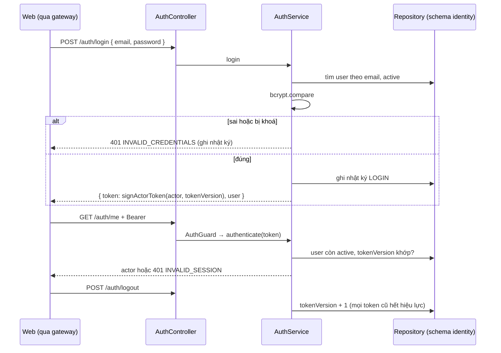

# Service `identity`

Thẻ của service: AI và người đọc tệp này trước khi sửa mã. Chủ service cập nhật nó trong mỗi PR
làm đổi phạm vi (luật ở mục 4 của `CLAUDE.md`, CI `pnpm check:docs`). Đây là **service mẫu**: các service khác chép cách tổ chức của nó.

## Thông tin

| | |
| --- | --- |
| Chủ | TV1 — Nguyễn Tiến Tuấn |
| Cổng mặc định | 3001 (`bootstrapService({ port: 3001 })`; `API_PORT`/`PORT` ghi đè) |
| Schema PostgreSQL | `PG_SCHEMA=identity` |
| Gọi qua gateway | `/api/v1/auth/*`, `/api/v1/resources/{organizations,users,settings}` |

## Sơ đồ mã

| Tệp | Làm gì |
| --- | --- |
| `main.ts` | Module gốc: `AuthController`, `BaseController` (CRUD `/resources`), `PermissionsController`, `AuditExportController`, `HealthController`; guard toàn cục `AuthGuard` rồi `RolesGuard` (thứ tự quan trọng); `bootstrapService({ port: 3001 })`, seed trước khi nghe |
| `auth.ts` | `AuthService`: `login`, `register` (tổ chức + quản trị), `demoAccounts`/`demoLogin`, `authenticate` (token → tài khoản còn hoạt động, đúng `tokenVersion`), `resetPassword`, `logout` (tăng `tokenVersion`), `seed`; `AuthGuard`; `AuthController` (route `/auth/*`); cờ `SIGNUP`, demo |
| `seed-directory.ts` | Danh bạ seed: tổ chức `OPS`, các công ty và tài khoản mẫu (`buildDirectory`), tài khoản nổi bật cho màn đăng nhập demo |

## Sơ đồ luồng

## Dữ liệu sở hữu

| Collection | Ý nghĩa | Khai báo trong `packages/contracts/resources.json`? |
| --- | --- | --- |
| organizations | Công ty (bên mua, nhà cung cấp) và đơn vị vận hành `OPS` | Có (mục nền) |
| users | Tài khoản, vai trò, `tokenVersion` để thu hồi token | Có (mục nền) |
| settings | Cấu hình hệ thống | Có (mục nền) |

## Endpoint

| Phương thức, đường dẫn | Quyền | Lỗi nghiệp vụ |
| --- | --- | --- |
| `POST /auth/login` | công khai | 401 `INVALID_CREDENTIALS` |
| `POST /auth/register` | công khai (tắt bằng `SIGNUP=false`) | 400 `INVALID_EMAIL`, `PASSWORD_MINIMUM_12_CHARACTERS`, `INVALID_ORGANIZATION_KIND`; 409 `EMAIL_TAKEN`, `ORGANIZATION_CODE_TAKEN`; 404 `SIGNUP_DISABLED` |
| `GET /auth/demo-accounts`, `POST /auth/demo-login` | công khai, chỉ khi bật demo | 404 `DEMO_LOGIN_DISABLED` |
| `GET /auth/me` | đã đăng nhập | 401 `INVALID_SESSION` |
| `POST /auth/logout` | đã đăng nhập | — (thu hồi mọi token cũ) |
| `POST /auth/users/:id/password` | `users:reset-password` | 404 `USER_NOT_FOUND`; 403 khi `ORG_ADMIN` đụng tài khoản không được quản |
| `POST /auth/reset-demo` | `demo:reset` | 404 `DEMO_LOGIN_DISABLED` |
| CRUD `/resources/{organizations,users,settings}` | theo `permissions.json` | lỗi của chassis (`VALIDATION_FAILED`, `VERSION_MISMATCH`…) |

## Token

Identity ký token bằng `signActorToken` (chassis): người gọi nằm trong claims, các service khác
kiểm chữ ký bằng `JwtAuthGuard` mà không gọi identity. Riêng identity (`AuthGuard`) kiểm thêm tài
khoản còn hoạt động và `tokenVersion` (đổi mật khẩu, đăng xuất, khoá tài khoản làm mọi token cũ
hết hiệu lực ở identity ngay; ở service khác hết khi token hết hạn `TOKEN_TTL`).

## Sự kiện

| Phát | Nhận |
| --- | --- |
| (sau) `user.disabled` để service khác chặn sớm | — |

## Nguồn CodeCash

| Tệp cũ | Sang | Trạng thái |
| --- | --- | --- |
| `apps/api/src/auth.ts` | `service/src/auth.ts` | Xong; token đổi sang `signActorToken`/`verifyActorToken` |
| Danh bạ seed (`OPS`, Nova An B010, Phú Minh S015) | `service/src/seed-directory.ts` | Xong |
| `tests/foundation/resource.test.mjs` | `service/test/resource.test.mjs` | Xong |
| Đăng ký công ty (bản BTL) | `service/test/auth.test.mjs` | Xong |

## Rà soát nghiệp vụ

- SoD-1 giữ nguyên: tự đăng ký chỉ tạo được công ty mới + `ORG_ADMIN`; `ORG_ADMIN` không tạo, không
  đổi mật khẩu tài khoản kiểm soát viên hay vai trò nền tảng (`orgAdminRefusal`).

## Cải tiến so với CodeCash

- Token mang người gọi trong claims: service khác xác thực không cần gọi identity (bản cũ là một
  khối, tra người dùng trong cùng cơ sở dữ liệu).
- Việc tiếp theo (TV1): DTO + `ValidationPipe` cho body, `POST /auth/refresh`, `openapi.yaml`.
